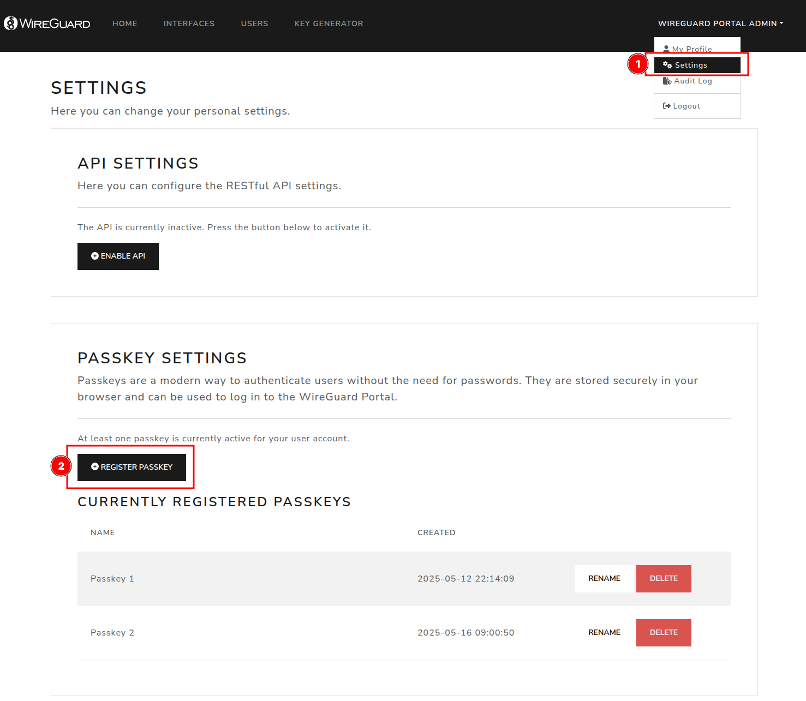

WireGuard Portal supports multiple authentication mechanisms to manage user access. This includes

 - Local user accounts
 - LDAP authentication
 - OAuth2 and OIDC authentication
 - Passkey authentication (WebAuthn)

Users can have two roles which limit their permissions in WireGuard Portal:

- **User**: Can manage their own account and peers.
- **Admin**: Can manage all users and peers, including the ability to manage WireGuard interfaces.

In general, each user is identified by a _unique identifier_. If the same user identifier exists across multiple authentication sources, WireGuard Portal automatically merges those accounts into a single user record.
When a user is associated with multiple authentication sources, their information in WireGuard Portal is updated based on the most recently logged-in source. For more details, see [User Synchronization](./user-sync.md) documentation.

## Password Authentication

WireGuard Portal supports username and password authentication for both local and LDAP-backed accounts.
Local users are stored in the database, while LDAP users are authenticated against an external LDAP server.

On initial startup, WireGuard Portal automatically creates a local admin account with the password `wgportal-default`.
> :warning: This password must be changed immediately after the first login.

The minimum password length for all local users can be configured in the [`auth`](../configuration/overview.md#auth)
section of the configuration file. The default value is **16** characters, see [`min_password_length`](../configuration/overview.md#min_password_length).
The minimum password length is also enforced for the default admin user.


## Passkey (WebAuthn) Authentication

Besides the standard authentication mechanisms, WireGuard Portal supports Passkey authentication.
This feature is enabled by default and can be configured in the [`webauthn`](../configuration/overview.md#webauthn-passkeys) section of the configuration file.

Users can register multiple Passkeys to their account. These Passkeys can be used to log in to the web UI as long as the user is not locked.
> :warning: Passkey authentication does not disable password authentication. The password can still be used to log in (e.g., as a fallback).

To register a Passkey, open the settings page *(1)* in the web UI and click on the "Register Passkey" *(2)* button.




## OAuth2 and OIDC Authentication

WireGuard Portal supports OAuth2 and OIDC authentication. You can use any OAuth2 or OIDC provider that supports the authorization code flow,
such as Google, GitHub, or Keycloak.

For OAuth2 or OIDC to work, you need to configure the [`external_url`](../configuration/overview.md#external_url) property in the [`web`](../configuration/overview.md#web) section of the configuration file.
If you are planning to expose the portal to the internet, make sure that the `external_url` is configured to use HTTPS.

To add OIDC or OAuth2 authentication to WireGuard Portal, create a Client-ID and Client-Secret in your OAuth2 provider and
configure a new authentication provider in the [`auth`](../configuration/overview.md#auth) section of the configuration file.
Make sure that each configured provider has a unique `provider_name` property set. Samples can be seen [here](../configuration/examples.md).

When registering the OAuth2 or OIDC application with your provider, configure the callback/redirect URL as follows:

```text
<external_url>/api/v0/auth/login/<provider_name>/callback
```

Replace `<external_url>` with the value configured in [`external_url`](../configuration/overview.md#external_url) and
`<provider_name>` with the exact `provider_name` from the matching OAuth2 or OIDC provider configuration.

#### Limiting Login to Specific Domains

You can limit the login to specific domains by setting the `allowed_domains` property for OAuth2 or OIDC providers.
This property is a comma-separated list of domains that are allowed to log in. The user's email address is checked against this list.
For example, if you want to allow only users with an email address ending in `outlook.com` to log in, set the property as follows:

```yaml
auth:
  oidc:
    - provider_name: "oidc1"
      # ... other settings
      allowed_domains:
        - "outlook.com"
```

#### Limiting Login to Specific User Groups

You can limit the login to specific user groups by setting the `allowed_user_groups` property for OAuth2 or OIDC providers.
If this property is not empty, the user's `user_groups` claim must contain at least one matching group.

To use this feature, ensure your group claim is mapped via `field_map.user_groups`.

```yaml
auth:
  oidc:
    - provider_name: "oidc1"
      # ... other settings
      allowed_user_groups:
        - "wg-users"
        - "wg-admins"
      field_map:
        user_groups: "groups"
```

If `allowed_user_groups` is configured and the authenticated user has no matching group in `user_groups`, login is denied.

Minimal deny-by-group example:

```yaml
auth:
  oauth:
    - provider_name: "oauth1"
      # ... other settings
      allowed_user_groups:
        - "vpn-users"
      field_map:
        user_groups: "groups"
```

#### Restricting Interfaces by User Group

You can restrict which users are allowed to provision peers for specific WireGuard interfaces by setting the `interface_filter` property for OAuth2 or OIDC providers.
This property is a map where each key corresponds to a WireGuard interface identifier, and the value is a regular expression.
The regular expression is matched against every entry of the user's `user_groups` claim, the same way as `admin_group_regex`.
A user will only be able to see and provision peers for an interface if at least one of their groups matches.

To use this feature, ensure your group claim is mapped via `field_map.user_groups`.

```yaml
auth:
  oidc:
    - provider_name: "oidc1"
      # ... other settings
      field_map:
        user_groups: "groups"
      interface_filter:
        wg0: "^vpn-users$"
        wg1: "^(vpn-admins|network-team)$"
```

The filter is evaluated on every login through the provider, and the result is stored in the database together with the time of the login.
This is the login-time counterpart of the LDAP `interface_filter`, which is evaluated during the LDAP synchronization.
Consequently, a change of group membership in the identity provider takes effect on the user's next login through that provider.
Access granted this way expires after `interface_filter_max_age` (default `24h`, the lifetime of a web session) unless the user logs in through the provider again.
Logins through other methods, such as passkeys, an existing session or API tokens, cannot extend it.
Set `interface_filter_max_age: 0s` to keep access until the next login through the provider.
Even if a user bypasses the UI, the backend will enforce these restrictions at the service layer.

```yaml
auth:
  oidc:
    - provider_name: "oidc1"
      # ... other settings
      interface_filter:
        wg0: "^vpn-users$"
      interface_filter_max_age: 8h
```

Please note:

- Interfaces without an `interface_filter` entry (in any OAuth2, OIDC or LDAP provider) remain available to all users.
- If several providers filter the same interface, a user matching any of them is allowed.
- Users that did not log in through a provider filtering an interface (e.g., local users) cannot provision peers for that interface.
- The filter gates provisioning only. Losing access does not disable existing peers, the same as for LDAP: the user can no longer create, edit or delete peers on that interface, but existing peers stay active and their configuration can still be downloaded until an administrator removes or disables them.
- Default peers are only created on a filtered interface if the user's access is already stored when the user is created, logs in without any peer, or the interface is created. Gaining access later does not create a default peer.
- Administrators are not restricted by interface filters.
- With the default `interface_filter_max_age`, users who only log in with passkeys lose the ability to create, edit or delete peers on a filtered interface after 24 hours, until they log in through the provider again.
- If the provider authenticates a user but the login is rejected (e.g., by `allowed_domains` or `allowed_user_groups`), or the login fails after the result was stored, the access stored for that provider is revoked.
- If the result cannot be stored, the login is rejected.
- Tightening or removing a filter does not revoke access that was already stored; it takes effect on the next login through the provider or after `interface_filter_max_age`.
- Stored access is bound to the `provider_name`: renaming a provider drops it, and reusing an old name brings back access stored under that name.
- The `provider_name` of OIDC and OAuth providers must be unique (case-insensitive); duplicates are rejected at startup.
- Access stored with a login time more than one minute in the future is ignored, so setting the clock back invalidates it until the next login.
- Deleting a user removes all access stored for them. A login and the deletion of the same user are serialized within one WireGuard Portal instance only; with several instances sharing a database, a login racing the deletion may leave stored access behind until it expires.

#### Limit Login to Existing Users

You can limit the login to existing users only by setting the `registration_enabled` property to `false` for OAuth2 or OIDC providers.
If registration is enabled, new users will be created in the database when they log in for the first time.

#### Admin Mapping

You can map users to admin roles based on their attributes in the OAuth2 or OIDC provider. To do this, set the `admin_mapping` property for the provider.
Administrative access can either be mapped by a specific attribute or by group membership.

**Attribute specific mapping** can be achieved by setting the `admin_value_regex` and the `is_admin` property.
The `admin_value_regex` property is a regular expression that is matched against the value of the `is_admin` attribute.
The user is granted admin access if the regex matches the attribute value.

Example:
```yaml
auth:
  oidc:
    - provider_name: "oidc1"
      # ... other settings
      field_map:
        is_admin: "wg_admin_prop"
      admin_mapping:
        admin_value_regex: "^true$"
```
The example above will grant admin access to users with the `wg_admin_prop` attribute set to `true`.

**Group membership mapping** can be achieved by setting the `admin_group_regex` and `user_groups` property.
The `admin_group_regex` property is a regular expression that is matched against the group names of the user.
The user is granted admin access if the regex matches any of the group names.

Example:
```yaml
auth:
  oidc:
    - provider_name: "oidc1"
      # ... other settings
      field_map:
        user_groups: "groups"
      admin_mapping:
        admin_group_regex: "^the-admin-group$"
```
The example above will grant admin access to users who are members of the `the-admin-group` group.


## LDAP Authentication

WireGuard Portal supports LDAP authentication. You can use any LDAP server that supports the LDAP protocol, such as Active Directory or OpenLDAP.
Multiple LDAP servers can be configured in the [`auth`](../configuration/overview.md#auth) section of the configuration file.
WireGuard Portal remembers the authentication provider of the user and therefore avoids conflicts between multiple LDAP providers.

To configure LDAP authentication, create a new [`ldap`](../configuration/overview.md#ldap) authentication provider in the [`auth`](../configuration/overview.md#auth) section of the configuration file.

### Limiting Login to Specific Users

You can limit the login to specific users by setting the `login_filter` property for LDAP provider. This filter uses the LDAP search filter syntax.
The username can be inserted into the query by placing the `{{login_identifier}}` placeholder in the filter. This placeholder will then be replaced with the username entered by the user during login.

For example, if you want to allow only users with the `objectClass` attribute set to `organizationalPerson` to log in, set the property as follows:

```yaml
auth:
  ldap:
    - provider_name: "ldap1"
      # ... other settings
      login_filter: "(&(objectClass=organizationalPerson)(uid={{login_identifier}}))"
```

The `login_filter` should always be designed to return at most one user.

### Limit Login to Existing Users

You can limit the login to existing users only by setting the `registration_enabled` property to `false` for LDAP providers.
If registration is enabled, new users will be created in the database when they log in for the first time.

### Admin Mapping

You can map users to admin roles based on their group membership in the LDAP server. To do this, set the `admin_group` and `memberof` property for the provider.
The `admin_group` property defines the distinguished name of the group that is allowed to log in as admin.
All groups that are listed in the `memberof` attribute of the user will be checked against this group. If one of the groups matches, the user is granted admin access.

### Interface-specific Provisioning Filters

You can restrict which users are allowed to provision peers for specific WireGuard interfaces by setting the `interface_filter` property.
This property is a map where each key corresponds to a WireGuard interface identifier, and the value is an LDAP filter.
A user will only be able to see and provision peers for an interface if they match the specified LDAP filter for that interface.

Example:
```yaml
auth:
  ldap:
    - provider_name: "ldap1"
      # ... other settings
      interface_filter:
        wg0: "(memberOf=CN=VPNUsers,OU=Groups,DC=COMPANY,DC=LOCAL)"
        wg1: "(department=IT)"
```

This feature works by materializing the list of authorized users for each interface during the periodic LDAP synchronization.
Even if a user bypasses the UI, the backend will enforce these restrictions at the service layer.
Default peers are only created on a filtered interface for users that are already on its list.
An interface that is created, or a user that logs in, before the next synchronization lists them gets no default peer, and none is created later.


## User Synchronization

